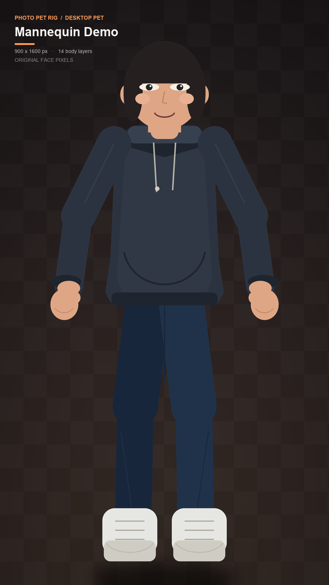
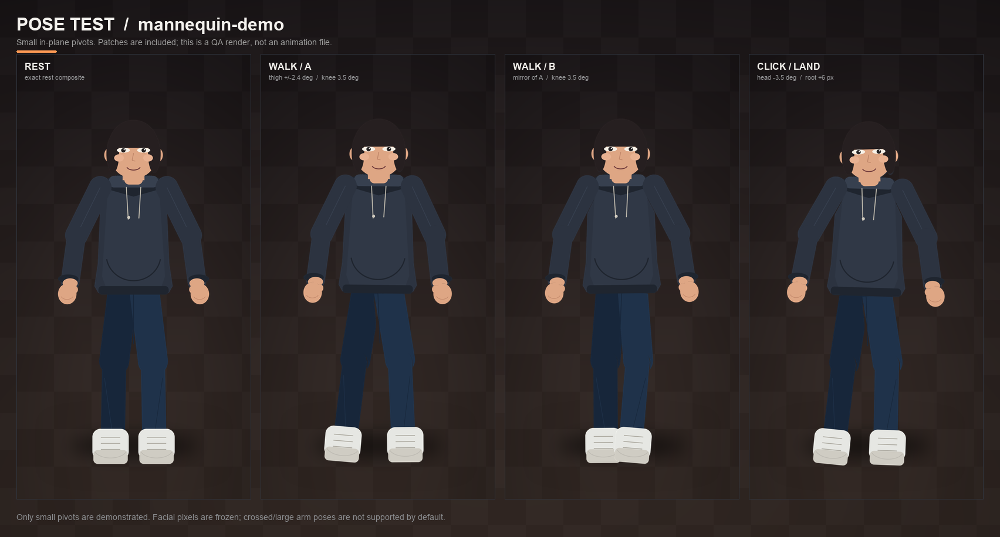

# photo-pet-rig

**用一张真人全身照片，做出可绑定 pivot 的 2D 桌宠分层素材。**  
**AI 负责“看懂照片并写标注”，程序负责确定性的裁切、补片、rig 和质检。**

> Photo → AI-written joint/part annotations → deterministic 2D cutout rig → Desktop.  
> No generative redraw of the person. Face pixels remain source pixels.



> 上面的示例是仓库自带的**合成 mannequin**，不是真人照片，也不是 AI 重绘结果。  
> 它只用于演示 14 层切件、同画布对齐、补片和 pivot 绑定。真实照片需要你自己提供并运行流程。


> 这个仓库还带一个可选的 **Windows 桌面运行时**：透明、置顶、可拖动、会走路/掉落/反弹，
> 直接渲染你的分层像素。上面是它实际渲染合成 demo 的 IDLE/WALK 两帧；不需要打开窗口。

- AI 提示词：[`prompts/AGENT.md`](prompts/AGENT.md) · [English](prompts/AGENT_EN.md) · [中文最短版](prompts/PROMPT_ZH.txt) · [English shortest](prompts/PROMPT.txt)
- 端到端“素材 → 桌面桌宠”提示词：[`prompts/DESKTOP_PET.md`](prompts/DESKTOP_PET.md) · [English](prompts/DESKTOP_PET_EN.md)
- 项目格式：[`prompts/PROJECT_SCHEMA.md`](prompts/PROJECT_SCHEMA.md)
- 可运行示例：[`examples/mannequin/project.json`](examples/mannequin/project.json)
- 骨骼图：[`docs/demo_rig.png`](docs/demo_rig.png) · 图层清单：[`docs/demo_layers.png`](docs/demo_layers.png) · 姿态测试：[`docs/demo_poses.png`](docs/demo_poses.png)
- 桌面运行时文档：[`docs/PET_RUNTIME.md`](docs/PET_RUNTIME.md) · 运行时演示素材：[`examples/demo_character/`](examples/demo_character/)

---

## 这个项目解决什么问题

单张照片无法像 3D 模型那样自动拆出真实的手臂、手掌和被遮挡的胸口。这个项目把流程拆成可验证的两部分，并附带一个可选的桌面运行时：

1. **AI/人**看照片，标注：
   - 15 个骨骼 pivot；
   - 14 个身体部件的可见区域多边形；
   - 脸部安全区域；
   - 哪些手/肢体被完全遮挡。
2. **程序**确定性地完成：
   - 透明底 alpha 处理；
   - 将像素分配给各部件（不重采样人物）；
   - 关节重叠、边缘去污染；
   - 从邻近真实布料生成补片；
   - 输出 14 个身体 PNG + 补片 + `rig.json` + 预览 + `qa_report.json`；
   - 复制到桌面并打 ZIP。
3. **可选运行时**（Windows）把 `rig.json` + 分层 PNG 变成透明置顶桌宠：
   - 分层骨骼旋转、参数化走路、重力/落地反弹/拖拽；
   - 单击/双击/右键菜单/托盘/本地气泡；
   - 缺素材或 rig 损坏时明确降级为整图模式；
   - 完全本地，不调用生成式 AI。

这样既能借助视觉 AI 理解人体，又能保证脸部像素和输出可复现。

**它不会：**

- 用生成式 AI 重画你的脸、手、衣服；
- 从一张照片恢复被手臂完全挡住的胸口/手掌；
- 自动识别任意照片的关节和肢体（目前需要 AI/人写 `project.json`）；
- 提供完整跑步、侧身、表情动画。

---

## 示例

| 合成角色 | pivot 测试 |
|---|---|
|  |  |

`examples/mannequin/` 是一个公开的合成测试角色，包含完整 14 层、11 个自动补片、脸部校验和姿态预览。它由 [`examples/make_mannequin.py`](examples/make_mannequin.py) 生成，可以自由修改。

---

## 快速开始

### 1. 安装

需要 Python **3.10+**。

> 如果你拿到的是 ZIP，先解压，再进入 `photo-pet-rig/` 执行下面的命令；不需要 Git。

```bash
git clone <your-fork-url> photo-pet-rig
cd photo-pet-rig

python -m venv .venv
# Windows PowerShell:
.venv\Scripts\Activate.ps1
# macOS/Linux:
source .venv/bin/activate

python -m pip install -e .
```

背景去除是可选步骤：

```bash
python -m pip install -e ".[rembg]"
```

`rembg` 首次运行会下载模型权重；模型权重和第三方许可不随本仓库分发。

### 2. 先跑合成示例

```bash
photopet build examples/mannequin/project.json
```

默认输出：

```text
<Desktop>/mannequin-demo_pet_assets/
<Desktop>/mannequin-demo_pet_assets.zip
```

想先输出到临时目录：

```bash
photopet build examples/mannequin/project.json --out ./output
```

### 3. 用自己的照片（推荐：让 AI agent 执行）

把 [`prompts/AGENT.md`](prompts/AGENT.md) 全文发给一个**能看图、能运行终端**的 AI 编码代理
（Claude Code、Codex、DeepSeek Harness 等），替换其中：

```text
PHOTO_PATH: /absolute/path/to/your/photo.jpg
OUTPUT_DIR: <你的桌面，可留空>
RIGHTS: I own this photo / I have permission to process and use it.
```

然后对代理说：

```text
请严格按照 prompts/AGENT.md（或最短版 prompts/PROMPT_ZH.txt）执行，实际生成文件并交付到桌面。
照片：<PHOTO_PATH>
```

代理会：

1. 判断照片是否适合；
2. 生成透明底；
3. 用 `photopet inspect` 的网格坐标标关节和多边形；
4. 写 `project.json`；
5. `photopet validate`；
6. `photopet build` 到桌面；
7. 检查 `qa_report.json` 和预览，不合格就迭代；
8. 报告能做什么、不能做什么。

如果你不想把照片上传到云端 AI：使用本地视觉模型/本地 agent，或按下一节手动标注。
本仓库自身不会上传照片；`rembg` 只会在首次使用时下载模型。使用云端 AI 的隐私策略由你选择的
服务商决定。

### 4. 手动工作流

```bash
# 1) 生成网格图和参考裁剪
photopet inspect photo.jpg -o inspect

# 2) 生成透明底（可选；也可以使用你自己的透明 PNG）
photopet cutout photo.jpg -o cutout.png

# 3) 参考 examples/mannequin/project.json 和 PROJECT_SCHEMA.md 写 project.json

# 4) 校验
photopet validate project.json

# 5) 构建到桌面
photopet build project.json --out "$HOME/Desktop"

# 已有输出时：
photopet build project.json --out "$HOME/Desktop" --force
```

---

## 桌面运行时（可选，Windows）

构建出的 `<slug>_pet_assets/` 可以直接跑起来，不需要再写代码：

```powershell
# 安装运行时（PySide6）
python -m pip install -e ".[pet]"

# 先用仓库自带的合成 demo 验证
photopet pet --assets examples/demo_character

# 换成你自己的素材
photopet pet --assets "C:\Users\<you>\Desktop\<slug>_pet_assets"
```

会得到一个**透明、无边框、始终置顶**的角色：可以拖动/抛出/落地反弹，会自主走动并在
屏幕边缘转向；单击/双击有不同反馈，右键和托盘可以打开设置、暂停和退出。透明区域
默认鼠标穿透，不抢键盘焦点。

- 不调用任何大模型或网络服务；所有物理/动画/气泡都在本地。
- 分层模式做真实关节旋转；素材缺失/`rig.json` 损坏时明确降级为整图，并提示无法做
  分肢动画，不会拿整张照片旋转冒充走路。
- 30 FPS 可配置，静止时降帧；图片只加载一次。
- 完整说明、状态机、配置字段、打包命令和限制见 [`docs/PET_RUNTIME.md`](docs/PET_RUNTIME.md)。

自己的照片从零走完整流程（含 AI 标注 → 构建 → 启动 → 验收）时，把
[`prompts/DESKTOP_PET.md`](prompts/DESKTOP_PET.md) 全文交给能看图、能跑终端的 AI agent。
不要上传或提交未经同意的真人照片。

Windows 打包：

```powershell
python -m pip install pyinstaller
powershell -ExecutionPolicy Bypass -File packaging\build_pet.ps1 -Python .venv\Scripts\python.exe
```

---

## 提示词 / Prompt

| 文件 | 用途 |
|---|---|
| [`prompts/AGENT.md`](prompts/AGENT.md) | 中文完整 agent 提示词：工作流、标注规则、QA、失败处理、交付格式。 |
| [`prompts/AGENT_EN.md`](prompts/AGENT_EN.md) | English full prompt (same workflow as the Chinese version). |
| [`prompts/PROMPT_ZH.txt`](prompts/PROMPT_ZH.txt) | 中文最短可粘贴版本，适合直接交给有视觉能力的 AI。 |
| [`prompts/PROMPT.txt`](prompts/PROMPT.txt) | English shortest version. |
| [`prompts/PROJECT_SCHEMA.md`](prompts/PROJECT_SCHEMA.md) | `project.json` 字段、15 骨骼、14 图层、z 顺序、补片和校验规则。 |
| [`prompts/DESKTOP_PET.md`](prompts/DESKTOP_PET.md) | 端到端提示词：检查照片 → 切图/标注 → 构建 → `photopet pet` 启动 → 验收，含成本/隐私约束。 |
| [`prompts/DESKTOP_PET_EN.md`](prompts/DESKTOP_PET_EN.md) | English end-to-end prompt: photo → rig → desktop runtime → acceptance. |

提示词的重点不是“让 AI 画一个桌宠”，而是：

- 先做**照片适合性判断**；
- 用绝对原图坐标写关节/多边形；
- 脸部多边形内逐像素保留；
- 看不见的手就留空，不伪造；
- 必须实际运行 builder，不能只给建议；
- 必须检查静态 QA 和姿态预览；
- 必须如实报告限制。

---

## CLI

### `photopet inspect`

```bash
photopet inspect photo.jpg -o inspect --grid 50
```

生成：

```text
inspect/
├─ grid.png
├─ crops/
│  ├─ head.png
│  ├─ head_grid.png
│  ├─ torso.png
│  ├─ torso_grid.png
│  ├─ legs.png
│  └─ legs_grid.png
└─ README.md
```

网格数字是**原图绝对坐标**，方便 AI 或人工填写 `project.json`。

### `photopet cutout`

```bash
photopet cutout photo.jpg -o cutout.png
photopet cutout photo.jpg -o cutout.png --keep-largest
```

调用可选依赖 `rembg` 做人像抠图。`--keep-largest` 只保留最大 alpha 连通域，适合去除第二个人/杂物；
但它也可能删除真实的分离肢体，使用前请检查 `cutout.png`。

也可以完全跳过这个命令，直接提供一个透明 PNG 或灰度 alpha：
在 `project.json` 中把 `alpha` 指向它即可。

### `photopet validate`

```bash
photopet validate project.json
```

不生成素材，只做结构和坐标校验。详见 [`prompts/PROJECT_SCHEMA.md`](prompts/PROJECT_SCHEMA.md)。

### `photopet build`

```bash
photopet build project.json
photopet build project.json --out D:\Desktop --force
photopet build project.json --alpha cutout.png --keep-largest --no-zip
```

| 参数 | 含义 |
|---|---|
| `--out DIR` | 输出父目录；默认桌面。实际会创建 `<slug>_pet_assets/`。 |
| `--alpha PATH` | 覆盖项目里的 alpha 路径。 |
| `--keep-largest` | 只保留最大 alpha 连通域。 |
| `--force` | 替换已存在的 `<slug>_pet_assets`（只允许这个名字结尾的文件夹）。 |
| `--no-zip` | 不生成 ZIP。 |
| `--no-patches` | 不生成关节补片（不建议用于动画）。 |

如果 `photopet` 命令不可用，使用：

```bash
python -m photopet build project.json
```

---

## 输出结构

```text
<slug>_pet_assets/
├─ character_original.png       # 完整参考图（由图层精确合成）
├─ head.png
├─ torso.png
├─ upper_arm_left.png
├─ forearm_left.png
├─ hand_left.png               # 被遮挡时可为全透明
├─ upper_arm_right.png
├─ forearm_right.png
├─ hand_right.png
├─ thigh_left.png
├─ shin_left.png
├─ foot_left.png
├─ thigh_right.png
├─ shin_right.png
├─ foot_right.png
├─ patch_layers/
│  ├─ patch_neck.png
│  ├─ patch_shoulder_left.png
│  └─ ...
├─ alpha_used.png               # 本次实际使用的 alpha
├─ rig.json                     # pivot、父节点、z、角度、来源、限制
├─ qa_report.json               # 逐像素和结构质检
├─ preview.png                  # 主预览
├─ preview_layers.png           # 同画布图层清单
├─ preview_rig.png              # 关节示意图
├─ preview_poses.png            # 小角度姿态测试
└─ README.md                    # 本次输出的说明
```

同名 ZIP 位于输出父目录。

**所有身体图层都保持原始画布的绝对位置**。导入引擎时不要自动裁边、不要单独居中；
按 `rig.json.draw_order` 的顺序、在 `(0,0)` 叠加，围绕 pivot 旋转。

---

## 构建器做了什么

1. **Alpha**
   - 读取 `project.alpha`、嵌入 alpha，或调用 rembg；
   - 可选保留最大连通域；
   - 将 `face.polygon` 内 alpha 强制为 255（只改透明度，不改脸的颜色）。
2. **部件标签**
   - 按 z 从高到低分配多边形；
   - 将边缘未覆盖的 alpha 像素按距离分配给最近部件；
   - 要求多边形覆盖至少 85% 前景，否则构建失败。
3. **脸部保护**
   - 脸像素强制归入 `head`；
   - 构建后验证 `head.png` 的脸部 RGB 与源图逐字节一致。
4. **重叠和补片**
   - 在关节处给子层补少量父层像素，减少旋转空洞；
   - 在肩、肘、髋、膝、踝、颈自动生成软补片，颜色来自邻近真实布料，补片永远在身体层后面；
   - 补片被裁剪到 `alpha == 255`，不改变外轮廓。
5. **预览和 QA**
   - 组合参考图、图层清单、骨骼图、小角度姿态图；
   - 重新组合图层并比较；
   - 补片静态隐藏检查；
   - 静态透明洞检查；
   - 输出 `rig.json` 和 `qa_report.json`。
6. **交付**
   - 默认写到桌面；
   - 同时生成 ZIP。

构建步骤**不调用生成式图像模型**。补片是邻近真实像素的复制/缩放/模糊/颜色匹配，不是重建被遮挡的身体。

---

## 质量门槛

`qa_report.json.summary` 里的这些字段应为 `true`：

```text
exact_layer_reassembly
face_pixels_unchanged
patches_hidden_at_rest
zero_enclosed_holes_at_rest
```

- **exact_layer_reassembly**：所有可见像素重新拼合后与 `character_original.png` 无 alpha/RGB 误差。
- **face_pixels_unchanged**：脸部多边形内 RGB 与源图逐字节一致，alpha 最小值为 255。
- **patches_hidden_at_rest**：静止姿态下加不加补片结果一致。
- **zero_enclosed_holes_at_rest**：静止图没有封闭透明洞。

姿态测试是**视觉参考**。腿/手臂之间原本的负空间在某些角度可能被围成“封闭透明区”，
这不等于身体图层内部出现漏洞；请以 `preview_poses.png` 的目视效果为准，不要只看数字。

---

## 适合与不适合

### 适合

- 正面全身或大半身照片；
- 头部、肩、肘、髋、膝、踝至少部分可见；
- 四肢没有被衣服完全合并；
- 脸部可见、清晰度足够；
- 允许你使用/公开的照片。

### 不适合或只能受限输出

- 双臂交叉、双手完全不可见：可以切件和做补片，但**不能做自然摆臂**；
- 只有侧身/背面：无法恢复另一侧；
- 长裙/长外套完全遮住腿：不能伪造腿部；
- 脸被遮住或转动过大：身份校验和表情动画受限；
- 严重遮挡、多人重叠、运动模糊：标注和抠像质量会明显下降。

一张照片就是一张平面视图。**它不能自动变成可 360° 旋转的 3D 模型，也不能产生未见过的侧脸/背面。**

---

## 渲染接入

所有 PNG 是 **straight alpha**。推荐流程：

1. 保留完整画布，不裁边、不重新居中；
2. 加载纹理时按需预乘 alpha；
3. 按 `rig.json.draw_order` 从后到前绘制；
4. 每个部件绕 `rig.json` 中对应 bone 的 `pivot` 旋转；
5. 缩放整个角色，而不是单独缩放某个部件；
6. 用 `character_original.png` 作为静止参考；
7. 桌面锚点用 `rig.json` 的 `character.anchor` / `character.ground_y`。

伪代码：

```text
for layer in rig.draw_order:
    bone = rig.bones[rig.layers[layer].bone]
    M = world_transform(bone)
    draw(layer.texture, pivot=bone.pivot, transform=M, z=layer.z_index)
```

补片也属于 `draw_order`，必须在身体图层之前绘制。

---

## 隐私、版权与伦理

- 只处理你拥有或获得许可的照片。
- 不要把人家的照片、alpha、`project.json` 或输出提交到 Git。
- 仓库的 `.gitignore` 已忽略 `private/`、`inputs/`、`outputs/`、`*_pet_assets/`、`*.zip`。
- 本仓库代码不会上传照片；但如果你把照片交给云端 AI agent，照片会经过该服务商。
- 如果使用 rembg，首次运行会联网下载模型权重；请同时遵守模型和 rembg 的许可。
- 不要把生成结果用于冒充、骚扰、虚假身份或未经同意的商业用途。

---

## 已知限制

- **不是全自动绑定**。必须有 AI/人写 `project.json`；程序不会从任意照片自动猜出所有关节和多边形。
- **单视图**。没有侧身、背面、头部 yaw/pitch 和表情通道。
- **手/肢体被遮挡时必须留空**，不能凭空补出真实细节。
- **补片是合成的**，只用于防空洞，不是被遮挡部位的真相。
- **大角度旋转会露缝**。推荐角度在 `rig.json` 里，是保守值。
- **姿态预览不保证任意角度**。它是 QA 参考，不是动画成品。
- **运行时只有小角度程序化动画**。交叉手臂、长裙、贴身衣物会进一步限制摆幅；要大幅摆臂/跑步请提供手臂分开的多张素材。
- **整图降级不是分肢动画**。缺层/rig 损坏时程序会明确提示，不会用整张照片旋转冒充走路。
- **桌面运行时以 Windows 为主要验证平台**。Linux/macOS 可以构建素材，但透明置顶/贯穿点击/托盘没有做同等验证。
- 极端角度、宽松衣物、长裙、交叉手臂都需要限制幅度或换照片。

---

## 开发与测试

```bash
python -m pip install -e ".[dev]"
python -m pytest -q
```

测试会用 `examples/mannequin` 实际构建一遍，验证：

- 14 个身体 PNG 和 11 个补片；
- 同一画布、RGBA；
- 图层重组零误差；
- 脸部 RGB 一致；
- 补片静态隐藏；
- 静止图没有封闭透明洞；
- 四类预览存在。

运行时测试还覆盖：物理子步/反弹、状态机优先级、释放速度、分层/整图降级加载、
DPI 渲染、配置校验、CLI 参数和合成 demo 的启动路径。Windows 桌面会话中的真实窗口
透明/焦点/命中测试用：

```powershell
photopet pet --assets examples/demo_character --smoke-test 3 --no-tray --smoke-report smoke.json
```

CI：GitHub Actions（见 `.github/workflows/tests.yml`）。

---

## 发布到 GitHub

这个仓库不要求先有 `.git` 历史。安装 Git 后，从 `photo-pet-rig\` 目录执行：

```bash
git init
git add .
git status          # 确认没有 *_pet_assets/、私人物料、dist/、logs/
git commit -m "Initial public release: photo-pet-rig + optional desktop runtime"
git branch -M main
git remote add origin https://github.com/<your-account>/photo-pet-rig.git
git push -u origin main
```

提交前请先看一遍 `git status`；`.gitignore` 已经排除 `inputs/`、`outputs/`、`private/`、
`*_pet_assets/`、`dist/`、`build/` 和本地 `config.json`。不要把别人的照片或未经授权的
素材强制提交（不要用 `git add -f` 绕过忽略规则）。

---

## 目录

```text
photo-pet-rig/
├─ photopet/                 # 构建器、CLI、模型、补片、预览、姿态测试
│  └─ pet/                   # 可选桌面运行时：窗口/物理/骨骼/状态机/托盘
├─ prompts/                  # agent 提示词、project schema、端到端运行流程
├─ examples/
│  ├─ make_mannequin.py
│  ├─ make_demo_character.py # 运行时用的合成演示角色
│  ├─ mannequin/             # 合成构建示例：photo/alpha/project.json
│  ├─ demo_character/        # 合成运行演示：14 层 + rig.json
│  └─ pet_config.example.json
├─ packaging/                # Windows PyInstaller 入口、配置和构建脚本
├─ tests/
├─ docs/                     # 合成示例截图 + 运行时文档/渲染图
├─ .github/workflows/
├─ pyproject.toml
├─ requirements.txt
├─ requirements-pet.txt
├─ LICENSE
└─ README.md
```

---

## License

代码、文档和合成示例采用 **MIT License**，见 [`LICENSE`](LICENSE)。

第三方依赖：

- Pillow — HPND
- NumPy — BSD-3-Clause
- OpenCV — Apache-2.0
- PySide6 / Qt（运行时可选项）— LGPLv3/GPLv3 或商业许可；打包分发前请确认义务。
- rembg（可选）— MIT；其下载的模型权重有各自许可，需单独确认。

本项目不包含 `rembg` 的模型权重，也不包含任何真人照片。

---

## 一句话总结

**AI 负责把照片“看懂并标注”，程序负责把像素“准确切开并验证”。**  
不适合从一张被遮挡的正面照片硬造出一套完整跑步动画；适合做一个诚实、可验证、可迭代的 2D 桌宠切件骨架。
