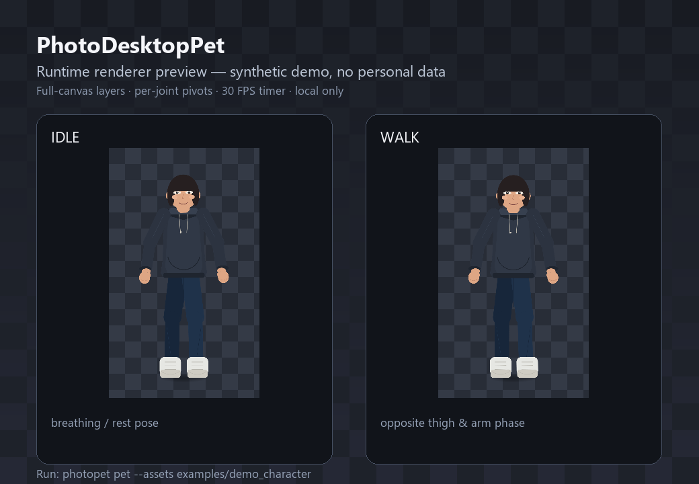

# 运行时验证记录

验证日期：2026-10-25  
环境：Windows 11 10.0.26200，125% 显示缩放单屏（Qt 工作区 1536×912）  
Python 3.12.15、PySide6 6.8.3、Pillow 11.3.0、PyInstaller 6.22.3

这份记录对应 **公开仓库的合成 demo**；没有使用任何真人照片。

---

## 1. 自动测试

```powershell
python -m pytest -q
```

结果：

```text
55 passed in 20.83s
```

55 项是 pytest 收集到的总数：`tests/test_build.py` 的合成构建测试按 unittest 类
收集为 3 项，运行时的物理/状态机/交互/配置/CLI/demo 测试共 52 项。

覆盖：

- 物理：重力、固定子步、地面/墙碰撞、反弹衰减、水平惯性、速度上限、非有限值清理。
- 状态机：进入/退出、优先级、拖拽优先、空中不走路、点击冷却、暂停、边缘转向。
- 交互：点击/拖拽阈值、释放速度、上抛负速度、陈旧轨迹不产生速度。
- 素材：`rig.json` 校验、分层加载、缺失/损坏降级、透明画布。
- 渲染：DPR 1.0/1.25/1.5、透明角、非空帧、合成 demo 分层。
- 配置：JSON/BOM、断点、越界值钳制、原子写入、绝对路径警告。
- CLI：`photopet pet` 参数、旧的 `build` 子命令不受影响。

运行无 warning；输出模式直接由 numpy 数组形状推断，兼容 Pillow 12/13。

---

## 2. 真实窗口冒烟（源码版）

```powershell
photopet pet --assets examples/demo_character `
  --smoke-test 3 --no-tray --smoke-report report.json
```

报告关键值：

```text
ok = true
mode = layered
mode_label = 分层骨骼模式
supports_limb_animation = true
window_visible = true
canvas = 900 x 1600
layer_count = 25
layout.window = 224 x 372
layout.render_dpr = 1.25
corner pixels = transparent
native_hit_test_ok = true
assets.warnings = []
assets.errors = []
```

`smoke_frame.png` 是窗口帧，`smoke_screen.png` 是桌面区域截图；两者都由程序在真实
Windows 桌面会话中生成。透明背景、非空人物、窗口可见、无致命帧错误均通过。

---

## 3. 打包版冒烟

```powershell
powershell -ExecutionPolicy Bypass -File packaging\build_pet.ps1 `
  -Python .venv\Scripts\python.exe

dist\pet\PhotoDesktopPet\PhotoDesktopPet.exe `
  --smoke-test 3 --no-tray --smoke-report packaged_report.json
```

结果：

```text
ok = true
mode = layered
mode_label = 分层骨骼模式
window_visible = true
```

构建产物是 onedir：`PhotoDesktopPet.exe` + `_internal/`（含 Qt 运行库和合成 demo）。
窗口版 exe 没有控制台，命令行返回后 smoke 仍在后台完成；验证时以报告文件和进程退出
为准，不要用“命令立即返回”判断失败。

---

## 4. 运行时截图



这张图由 `photopet.pet.character_renderer` 实际渲染 IDLE/WALK 两帧后合成；
背景棋盘格是“透明区域”的说明，不是窗口自身画的底。

---

## 5. 交互验收说明

在私有开发项目中，同一套运行时控制器还做过一次真实窗口交互冒烟：

- 单击 → `CLICK_REACT` → 回到 `IDLE`；
- 双击 → 更强的跳跃，落回地面；
- 拖拽 → `DRAG`，释放后 `FALL`，保留水平惯性并落地；
- 自主 `WALK`，接近边缘转向；
- 暂停后计时器停止，恢复后继续；
- 右键菜单、设置对话框、本地气泡、托盘菜单可见。

这些行为在公开仓库里由控制器测试和 `--smoke-test` 覆盖；公开仓库的默认素材是合成
demo，不包含真人照片，也不声称对任意真人素材都能达到同样的分肢幅度。

---

## 6. 隐私与仓库卫生

- `photo-pet-rig` 中没有真人照片、没有 `*_pet_assets/`、没有 `source_photo.jpg`。
- 合成 demo 由 `examples/make_demo_character.py` 生成，不使用生成式模型。
- 构建产物 `dist/`、`build/`、日志和本地 `config.json` 已被 `.gitignore` 排除。
- 运行时默认不联网；文字气泡只读本地配置。
