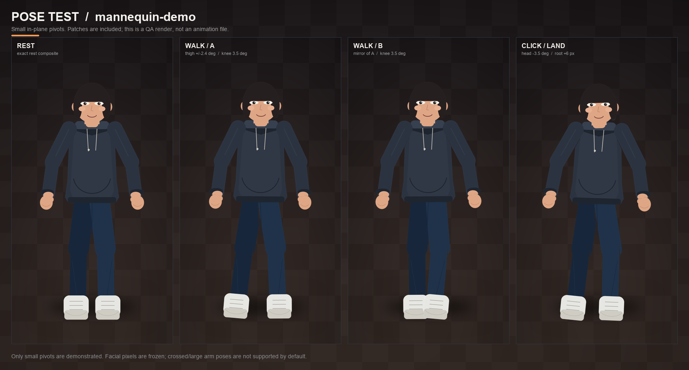

# mannequin_demo — 2D photo pet rig

Generated with **photo-pet-rig 0.1.0**.

- Canvas: **900 × 1600 px**, origin top-left
- Source: `photo.png` (SHA-256 `cdf66b5ff010ac129237852eaa60c5370580e596a23ce6b284956d3210a91576`)
- Visible bounding box: `[135, 109, 764, 1537]`
- Ground anchor: `[449.5, 1537]`
- All body layers keep the full original canvas; do not trim or re-center them.




## Body layers

| File | Alpha px | bbox | Pivot |
|---|---:|---|---:|
| `head.png` | 47,803 | `[326, 109, 573, 380]` | `[450.0, 350.0]` |
| `torso.png` | 131,178 | `[285, 338, 614, 837]` | `[450.0, 815.0]` |
| `upper_arm_left.png` | 22,990 | `[541, 342, 735, 620]` | `[588.0, 392.0]` |
| `forearm_left.png` | 19,480 | `[647, 551, 764, 805]` | `[686.0, 590.0]` |
| `hand_left.png` | 5,801 | `[677, 782, 764, 877]` | `[712.0, 790.0]` |
| `upper_arm_right.png` | 23,074 | `[164, 342, 359, 621]` | `[312.0, 392.0]` |
| `forearm_right.png` | 19,485 | `[135, 551, 253, 805]` | `[214.0, 590.0]` |
| `hand_right.png` | 5,808 | `[135, 782, 222, 877]` | `[188.0, 790.0]` |
| `thigh_left.png` | 33,206 | `[434, 807, 594, 1148]` | `[498.0, 815.0]` |
| `shin_left.png` | 31,812 | `[478, 1070, 587, 1395]` | `[532.0, 1080.0]` |
| `foot_left.png` | 21,630 | `[467, 1387, 622, 1537]` | `[535.0, 1400.0]` |
| `thigh_right.png` | 30,880 | `[305, 807, 448, 1147]` | `[402.0, 815.0]` |
| `shin_right.png` | 31,804 | `[313, 1070, 421, 1395]` | `[368.0, 1080.0]` |
| `foot_right.png` | 21,628 | `[277, 1387, 432, 1537]` | `[365.0, 1400.0]` |

The two hand files can be empty when the hands are not visible in the photo. Empty hand layers are still present for interface compatibility.

## Repair patches

These are **synthetic** fabric fills sampled from nearby visible pixels. They are rendered behind every body layer and are invisible at rest. They are not recovered hidden anatomy.

| File | Alpha px | bbox | Pivot |
|---|---:|---|---:|
| `patch_layers/patch_neck.png` | 31,904 | `[305, 270, 595, 430]` | `(450.0, 350.0)` |
| `patch_layers/patch_shoulder_left.png` | 18,341 | `[482, 315, 666, 474]` | `(588.0, 392.0)` |
| `patch_layers/patch_shoulder_right.png` | 18,430 | `[233, 314, 418, 474]` | `(312.0, 392.0)` |
| `patch_layers/patch_elbow_left.png` | 10,286 | `[621, 527, 732, 653]` | `(686.0, 590.0)` |
| `patch_layers/patch_elbow_right.png` | 10,335 | `[168, 527, 279, 653]` | `(214.0, 590.0)` |
| `patch_layers/patch_hip_left.png` | 21,023 | `[407, 740, 589, 890]` | `(498.0, 815.0)` |
| `patch_layers/patch_hip_right.png` | 21,042 | `[311, 740, 493, 890]` | `(402.0, 815.0)` |
| `patch_layers/patch_knee_left.png` | 13,073 | `[464, 1017, 591, 1143]` | `(532.0, 1080.0)` |
| `patch_layers/patch_knee_right.png` | 13,097 | `[309, 1017, 436, 1143]` | `(368.0, 1080.0)` |
| `patch_layers/patch_ankle_left.png` | 9,589 | `[475, 1348, 596, 1452]` | `(535.0, 1400.0)` |
| `patch_layers/patch_ankle_right.png` | 9,578 | `[304, 1348, 425, 1452]` | `(365.0, 1400.0)` |

## Draw order

`patch_neck → patch_shoulder_left → patch_shoulder_right → patch_elbow_left → patch_elbow_right → patch_hip_left → patch_hip_right → patch_knee_left → patch_knee_right → patch_ankle_left → patch_ankle_right → thigh_right → thigh_left → shin_right → shin_left → foot_right → foot_left → torso → upper_arm_right → upper_arm_left → forearm_right → forearm_left → hand_right → hand_left → head`

## Quality checks

- Layer reassembly: **True** (445,924 visible pixels, 0 alpha errors, 0 RGB errors)
- Patches invisible at rest: **True**
- Enclosed transparent holes at rest: **0**
- Face region: **19,854 px**, RGB identical to source: **True**, alpha min **255**. SHA-256: `132f9c3a667ea7d31bcfab275c8489591619f89d4b094f9eb3c5720927032f54`.

Pose tests are a visual aid; narrow negative space between limbs can look enclosed at some angles. Inspect `preview_poses.png` rather than treating its pixel count as a pass/fail signal.

## Render

Straight alpha PNG. If the engine filters/rotates textures, premultiply alpha first. Load each layer at `(0, 0)` on the full `900 × 1600` canvas and rotate around the pivot listed in `rig.json`. Do not auto-trim individual layers.

## Limitations

- Synthetic mannequin generated by examples/make_mannequin.py. It tests geometry only; it is not a real person or a result produced from a photo.
- This is a single-view photo rig. Head yaw/pitch, side views and back views are not authored.
- The face is frozen source pixels. No eye, mouth, mask or expression deformation is available.
- Rigid layers can show a thin seam or a notch at large joint rotations; the patch layers are synthetic fabric fills, not recovered anatomy.
- Patches are invisible at rest but may look repetitive if exposed by extreme poses.
- This is a 2D pivot rig, not a 3D or cloth-simulation model.

## Reproduce / edit

Edit `project.json` outside this folder, then rebuild with:

```bash
photopet build project.json --out <parent-folder> --force
```

The source photo is not duplicated in this output.
